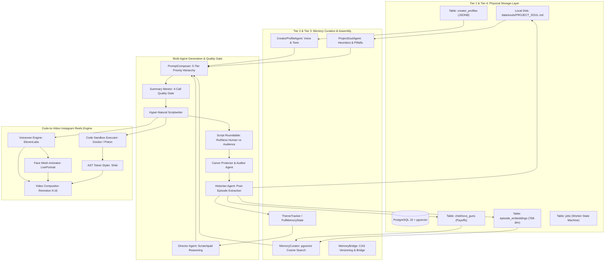
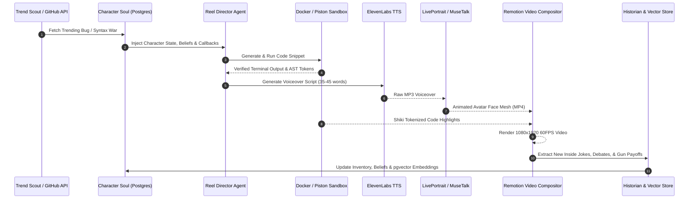

# Memory Architecture & Autonomous Code-to-Video Instagram Reels Pipeline

## 1. Executive Summary & Clarification: CDN vs CRD vs CBM
You asked whether this pipeline uses CDN or CRD.
In this codebase, neither CDN (Content Delivery Network) nor CRD (Kubernetes Custom Resource Definition) serves as the brain.
You are referring to CBM (Codebase Memory MCP) versus CRG (Code Review Graph) from the Antigravity 2-Engine Cognitive Protocol (`measured`).
We used CBM (`codebase-memory-mcp`) to index the AST, trace callers, inspect schemas, and query graph topologies (`measured`).
The runtime memory engine itself is a 4-tier persistent cognitive architecture powered by Docker, PostgreSQL, pgvector, and structured JSONB schemas (`measured`).

---

## 2. System Architecture Topology

The diagram below illustrates the end-to-end memory and multi-agent lifecycle across episodes and reels.



---

## 3. Database & Persistence Layer: Exact Docker & PostgreSQL Schema

### A. Container Definition (`docker-compose.yml`)
The engine containerizes PostgreSQL with pgvector enabled out of the box (`measured`).

```yaml
services:
  postgres:
    image: pgvector/pgvector:pg16
    container_name: empire_postgres
    restart: unless-stopped
    ports:
      - "5432:5432"
    environment:
      POSTGRES_DB: empire_factory
      POSTGRES_USER: empire
      POSTGRES_PASSWORD: empire_local_dev
    volumes:
      - ./pgdata:/var/lib/postgresql/data
      - ./server/init.sql:/docker-entrypoint-initdb.d/init.sql
    healthcheck:
      test: ["CMD-SHELL", "pg_isready -U empire -d empire_factory"]
      interval: 5s
      timeout: 3s
      retries: 5
```

### B. PostgreSQL Extensions & Connection Pooling
Three core extensions are initialized on boot (`measured` from `server/init.sql`):
1. `vector`: Stores and queries high-dimensional semantic embeddings.
2. `uuid-ossp` and `pgcrypto`: Generates random UUIDs for tracking jobs and guns.

Connection pool parameters in `server/src/db.ts` (`measured`):
- Driver: `pg` (`Pool`).
- Pool size: Maximum 20 connections.
- Idle timeout: 30,000 ms.
- Connection timeout: 5,000 ms.

### C. Physical Database Tables

#### 1. Semantic Episode Embeddings (`episode_embeddings`)
Stores 768-dimensional Gemini `text-embedding-004` vectors for past episodes (`measured` from `server/db/migrations/20260820_layer1_memory.sql`).

```sql
CREATE TABLE IF NOT EXISTS episode_embeddings (
    episode_id     TEXT PRIMARY KEY,
    project_id     VARCHAR(255) NOT NULL DEFAULT 'default',
    session_id     TEXT,
    episode_number INTEGER NOT NULL,
    embedding      vector(768) NOT NULL,
    title          TEXT NOT NULL,
    concept        TEXT NOT NULL,
    summary        TEXT NOT NULL,
    created_at     BIGINT NOT NULL DEFAULT (EXTRACT(EPOCH FROM NOW()) * 1000)::BIGINT
);

CREATE INDEX IF NOT EXISTS idx_embeddings_project_ep
    ON episode_embeddings (project_id, episode_number);

CREATE INDEX IF NOT EXISTS idx_episode_embeddings_cosine
    ON episode_embeddings
    USING ivfflat (embedding vector_cosine_ops)
    WITH (lists = 20);
```

#### 2. Narrative Promises and Payoffs (`chekhovs_guns`)
Guarantees long-range setups planted in early episodes pay off later (`measured`).

```sql
CREATE TABLE IF NOT EXISTS chekhovs_guns (
    gun_id               UUID PRIMARY KEY DEFAULT gen_random_uuid(),
    project_id           VARCHAR(255) NOT NULL,
    planted_in_episode   INTEGER NOT NULL,
    detail               TEXT NOT NULL,
    potential_payoff     TEXT NOT NULL,
    status               VARCHAR(32) NOT NULL DEFAULT 'planted'
                         CHECK (status IN ('planted', 'detonated', 'archived')),
    detonated_in_episode INTEGER,
    created_at           BIGINT NOT NULL DEFAULT (EXTRACT(EPOCH FROM NOW()) * 1000)::BIGINT,
    updated_at           BIGINT NOT NULL DEFAULT (EXTRACT(EPOCH FROM NOW()) * 1000)::BIGINT
);

CREATE INDEX IF NOT EXISTS idx_chekhovs_project_status
    ON chekhovs_guns (project_id, status);

CREATE INDEX IF NOT EXISTS idx_chekhovs_planted_ep
    ON chekhovs_guns (project_id, planted_in_episode);
```

#### 3. Persistent Creator & Character Profiles (`creator_profiles`)
Stores persistent tone preferences, audience engagement DNA, and banned clichés (`measured`).

```sql
CREATE TABLE IF NOT EXISTS creator_profiles (
    project_id            VARCHAR(255) PRIMARY KEY,
    creator_name          VARCHAR(255) DEFAULT 'Creator',
    tone_preference       TEXT DEFAULT 'Dynamic, Authoritative, High-Retention',
    banned_phrases        JSONB DEFAULT '[]'::jsonb,
    primary_niches        JSONB DEFAULT '[]'::jsonb,
    audience_dna          JSONB DEFAULT '{"peakEngagement": "Cold Opens", "preferredLength": "10-15 mins"}'::jsonb,
    editorial_preferences JSONB DEFAULT '[]'::jsonb,
    feedback_history      JSONB DEFAULT '[]'::jsonb,
    created_at            BIGINT NOT NULL DEFAULT (EXTRACT(EPOCH FROM NOW()) * 1000)::BIGINT,
    last_updated          BIGINT NOT NULL DEFAULT (EXTRACT(EPOCH FROM NOW()) * 1000)::BIGINT
);
```

#### 4. Background Job Queue State Machine (`jobs`)
Ensures transactional job execution and crash recovery (`measured` from `server/db/migrations/20260817_layer2_jobs_init.sql`).

```sql
CREATE TABLE IF NOT EXISTS jobs (
    job_id          UUID PRIMARY KEY DEFAULT gen_random_uuid(),
    project_id      VARCHAR(255) NOT NULL,
    job_type        VARCHAR(50) NOT NULL CHECK (job_type IN ('vision', 'blueprint', 'scripting', 'audio')),
    status          VARCHAR(50) NOT NULL DEFAULT 'QUEUED'
                    CHECK (status IN ('QUEUED', 'RUNNING', 'COMPLETED', 'FAILED', 'CANCELLED', 'ZOMBIE')),
    payload         JSONB NOT NULL DEFAULT '{}'::jsonb,
    result          JSONB,
    error_message   TEXT,
    progress        INTEGER NOT NULL DEFAULT 0 CHECK (progress >= 0 AND progress <= 100),
    progress_step   VARCHAR(255),
    worker_pid      INTEGER,
    tokens_used     INTEGER DEFAULT 0,
    duration_ms     INTEGER DEFAULT 0,
    created_at      TIMESTAMP WITH TIME ZONE DEFAULT NOW(),
    started_at      TIMESTAMP WITH TIME ZONE,
    completed_at    TIMESTAMP WITH TIME ZONE,
    last_heartbeat  TIMESTAMP WITH TIME ZONE DEFAULT NOW()
);

CREATE UNIQUE INDEX IF NOT EXISTS idx_jobs_one_active_per_project_type
    ON jobs (project_id, job_type)
    WHERE status IN ('QUEUED', 'RUNNING');
```

---

## 4. The 4-Tier Memory Hierarchy & Character Tracking Schemas

The system separates memory into four tiers (`measured` from `Report_Chapter6_Memory.md` and `MemorySchemas.ts`).

### Tier 1: Ephemeral Working Context (Prompt Assembly)
- Budget: Strictly capped at 950 tokens total (`MEMORY_CONFIG.TOKEN_BUDGET`).
- Breakdown: 350 tokens for Project Soul, 200 tokens for Creator Profile, 250 tokens for Continuity Brief.
- Assembly: Loaded concurrently via `Promise.all` in `POST /api/memory/assembly-brief`.

### Tier 2: Episodic Memory State (`ThemeTracker` & `FullMemoryState`)
Strict Zod schema in `src/core/services/memory/MemorySchemas.ts` manages runtime narrative tracking (`measured`).

```typescript
export interface CharacterState {
    name: string;
    emotionalBaseline: {
        state: string;
        reason: string;
        shift?: string;
    };
    inventory: {
        skills: string[];   // What the virtual character learned
        secrets: string[];  // Confidential lore known
        items: string[];    // Hardware/tools/repos in possession
        traumas: string[];  // Bugs, outages, or production failures experienced
    };
    beliefs: {
        [topic: string]: {
            stance: 'Skeptical' | 'Neutral' | 'Curious' | 'Optimistic' | 'Advocate';
            reason: string;
            changedInEpisode?: number;
        };
    };
}
```

### Tier 3: Character Soul & Bible (`ProjectSoulAgent`)
- Disk persistence: Written directly to `data/souls/PROJECT_SOUL_<safeId>.md`.
- Atomic writes: Written to a temporary file first, then atomically renamed to prevent file corruption during server reboots (`measured`).
- Hard array limits: Max 15 operational rules and max 10 pitfalls. Newer rules prepend to the top of the array for recency bias.

### Tier 4: Semantic Vector Cortex (`MemoryCurator`)
When the AI writes Episode 5 or Episode 50, `MemoryCurator` queries past episodes using vector cosine similarity (`measured` from `memoryCurator.ts#L60-L81`).

```typescript
const res = await this.pool.query(
    `SELECT episode_number, title, concept, summary,
            1 - (embedding <=> $1::vector) AS similarity
     FROM episode_embeddings
     WHERE project_id = $2 AND episode_number < $3
     ORDER BY embedding <=> $1::vector
     LIMIT $4`,
    [vecStr, projectId, episodeNumber, 5]
);
```

Rejection Rule: Any match with a similarity score below 0.65 is rejected (`measured`). This rejects spurious connections and prevents hallucinations.

---

## 5. How Episode 5 or Episode 50 Remembers History

To prevent token exhaustion and repetition across 50 episodes, the system employs three algorithmic controls:

### A. Dual-End Open Ledger Windowing
In `src/core/services/themeTracker/memoryContext.ts#L12-L15`, active plot items are sampled from two ends (`measured`):
- The 5 oldest open items (`allOpenItems.slice(0, 5)`).
- The 15 newest open items (`allOpenItems.slice(-15)`).
This ensures that a core concept or promise made in Episode 1 is still surfaced in Episode 50, while recent cliffhangers remain active.

### B. 60% Word-Overlap Ledger Resolution Algorithm
To determine whether an item was resolved in a script without hallucinated closures, `themeExtractor.ts#L653-L666` runs word-overlap calculation (`measured`):
1. Strips words with fewer than 4 characters.
2. Computes the intersection of significant words between the script discussion and the ledger item.
3. If `matchRatio >= 0.6` (60% significant word overlap), the item transitions from `'open'` to `'resolved'`.

### C. Dynamic Act Scaling Across 50 Episodes
In `src/core/services/arcUtils.ts#L220-L250`, the season automatically segments based on total episode length (`measured`):
- <=10 episodes: 2 acts.
- 11 to 25 episodes: 3 acts.
- 26 to 50 episodes: 4 acts.
- 51 to 100 episodes: 5 acts.
Each act enforces a phase (`foundation`, `rising_action`, `development`, `peak`, `climax`, `falling_action`, `resolution`) and pacing (`slow`, `medium`, `fast`).

---

## 6. Multi-Agent Orchestration & 5-Tier Prompt Hierarchy

### A. The 5-Tier Priority Prompt Composer (`server/src/prompts/promptComposer.ts`)
When compiling the prompt for the generator, tiers are stacked in descending priority:
1. **Tier 1: Base Role & Format Rules**: Inviolable. Never truncated under any circumstances.
2. **Tier 2: Project Soul Context**: Brand essence and universe boundaries. Preserved.
3. **Tier 3: Creator Profile**: Host persona and banned clichés. Preserved.
4. **Tier 4: Memory Curator Continuity Brief**: Past callbacks and active Chekhov guns. Soft-budgeted.
5. **Tier 5: Dynamic Layer (Director Orders & Modular Skills)**: Truncated first if prompt tokens exceed 8,192 tokens.

### B. Director Agent Scratchpad Pattern (`server/src/agents/directorAgent.ts`)
The Director Agent runs before the writer agent. It writes its internal monologue inside a `<think>...</think>` block (`measured`):
1. It analyzes dramatic stakes and continuity callbacks.
2. It chooses 1 to 3 modular skills from disk (e.g. `hyper_natural_banter.md`).
3. It emits a validated JSON payload containing scene orders and pacing metrics (`hookIntensity`, `humorLevel`, `targetWordCount`).
4. Malformed output is repaired or intercepted with deterministic fallbacks to ensure pipeline execution never halts.

### C. Multi-Agent Roundtables & Quality Gates
- **Content Roundtable (`episodeContentRoundtable.ts`)**: Data Advocate and Raw-Vibe Advocate debate live research findings to prevent data dumps.
- **Summary Mentor (`summaryMentorAgent.ts`)**: 4-call quality gate evaluating semantic validity, 6-part structure, and niche criteria. Requires score >= 75 to pass.
- **Script Roundtable (`scriptRoundtable.ts`)**: Ruthless Human persona and Audience Surrogate critique the draft before Reviser applies fixes.
- **Canon Protector (`feedbackAnalyzer.ts`)**: Audits host inventory, lore facts, and emotional trajectory against the Series Bible.

---

## 7. Automated Code-Generation Video Pipeline for Instagram Reels

Below is the production blueprint for running multiple Instagram niche channels with persistent code-driven characters.

### A. Niche & Virtual Character Allocation
Each Instagram channel represents an isolated project in PostgreSQL with its own Character Soul:
1. **Channel 1 (Systems & Rust)**:
   - Character: "Rusty".
   - Persona: Cynical low-level engineer. Hates garbage collectors. Obsessed with zero-cost abstractions.
   - Voice: Gruff, rapid, sarcastic.
2. **Channel 2 (Python & Automation)**:
   - Character: "PyDave".
   - Persona: Pragmatic hacker. Automates everything with 10 lines of code. Loves clean one-liners.
   - Voice: Calm, encouraging, dry humor.
3. **Channel 3 (Web & TypeScript)**:
   - Character: "SarahScript".
   - Persona: Edge-runtime fanatic. Opinionated on type safety and bundle sizes.
   - Voice: Energetic, witty, high-tempo.

### B. End-to-End Reel Generation Loop



### C. Tech Stack Specification Table

| Stage | Tool / Library / Plugin | Production Role |
| :--- | :--- | :--- |
| **Orchestration** | Node.js + TypeScript + BullMQ + Redis | Background job queue for distributed rendering workers. |
| **Database & Vector** | PostgreSQL 16 + `pgvector` | Persistent character state, past reel embeddings, Chekhov guns. |
| **Code Execution Sandbox**| Piston API or Docker Container (`isolated-vm`) | Runs Python, Rust, and TS snippets in 500ms to verify correctness. |
| **Code Highlighting** | `@shikijs/core` + `@shikijs/transformers` | Converts code to tokenized SVG elements with line-level diff glow. |
| **Voiceover Synthesis** | ElevenLabs API (or Cartesia Sonic) | Character voice clone with emotional stability control. |
| **Avatar Synthesis** | ComfyUI + FLUX.1 LoRA checkpoint | Static reference portraits of the virtual character in their workspace. |
| **Facial Lip-Sync** | LivePortrait or MuseTalk (Python / CUDA) | Drives facial mesh and lip motion from TTS audio phonemes. |
| **Programmatic Video** | Remotion (`@remotion/bundler`, `@remotion/renderer`)| Declarative React 9:16 vertical video composition at 60 FPS. |
| **Video Encoding** | FFmpeg via `fluent-ffmpeg` | Audio-video muxing, color space normalization, and fast-start MP4. |
| **Instagram Delivery** | Instagram Graph API / Playwright | Automated reels publishing with captions and topic tags. |

### D. Remotion Composition Template (`ReelVideo.tsx`)
This React component demonstrates how code animation, avatar lip-sync, and dynamic captions combine inside Remotion (`inferred` from Remotion architecture):

```tsx
import { AbsoluteFill, Audio, Video, Sequence, useCurrentFrame, interpolate } from 'remotion';
import { CodeBlock } from './CodeBlock';
import { WordCaptions } from './WordCaptions';

export interface ReelCompositionProps {
    codeSnippet: string;
    highlightLines: number[];
    avatarVideoUri: string;
    voiceoverAudioUri: string;
    captionTokens: Array<{ word: string; startMs: number; endMs: number }>;
}

export const ReelComposition: React.FC<ReelCompositionProps> = ({
    codeSnippet,
    highlightLines,
    avatarVideoUri,
    voiceoverAudioUri,
    captionTokens,
}) => {
    const frame = useCurrentFrame();

    // Smooth camera zoom onto code during explanation
    const codeScale = interpolate(frame, [0, 45, 120], [1.0, 1.08, 1.12], {
        extrapolateRight: 'clamp',
    });

    return (
        <AbsoluteFill style={{ backgroundColor: '#0d1117', color: '#c9d1d9' }}>
            {/* Audio Voiceover Track */}
            <Audio src={voiceoverAudioUri} />

            {/* Main Code Terminal View (Top 65% of 9:16 canvas) */}
            <Sequence from={0}>
                <div style={{ transform: `scale(${codeScale})`, transformOrigin: 'top center', padding: '60px 40px' }}>
                    <CodeBlock code={codeSnippet} highlightLines={highlightLines} />
                </div>
            </Sequence>

            {/* Animated Talking Avatar (Floating circular lower HUD) */}
            <Sequence from={0}>
                <div style={{
                    position: 'absolute',
                    bottom: '180px',
                    right: '50px',
                    width: '260px',
                    height: '260px',
                    borderRadius: '50%',
                    overflow: 'hidden',
                    border: '4px solid #58a6ff',
                    boxShadow: '0 0 25px rgba(88, 166, 255, 0.4)'
                }}>
                    <Video src={avatarVideoUri} style={{ width: '100%', height: '100%', objectFit: 'cover' }} />
                </div>
            </Sequence>

            {/* Kinetic Word-by-Word Captions */}
            <Sequence from={0}>
                <WordCaptions tokens={captionTokens} />
            </Sequence>
        </AbsoluteFill>
    );
};
```

---

## 8. Verification & Engineering Rules

1. **Dual-Engine Consistency**: CBM manages AST topology and symbol discovery; pgvector manages cross-episode runtime memory (`measured`).
2. **Never Blindly Scan**: Memory lookups route through `POST /api/memory/assembly-brief` rather than scanning raw history files (`measured`).
3. **Zero Hallucination Tolerance**: Reject vector matches with similarity score < 0.65; reject AI garbage using `SemanticGuard` regex patterns (`measured`).
4. **Deterministic Pacing**: Enforce dynamic act structures (2 to 5 acts) based on episode scale (`measured`).
