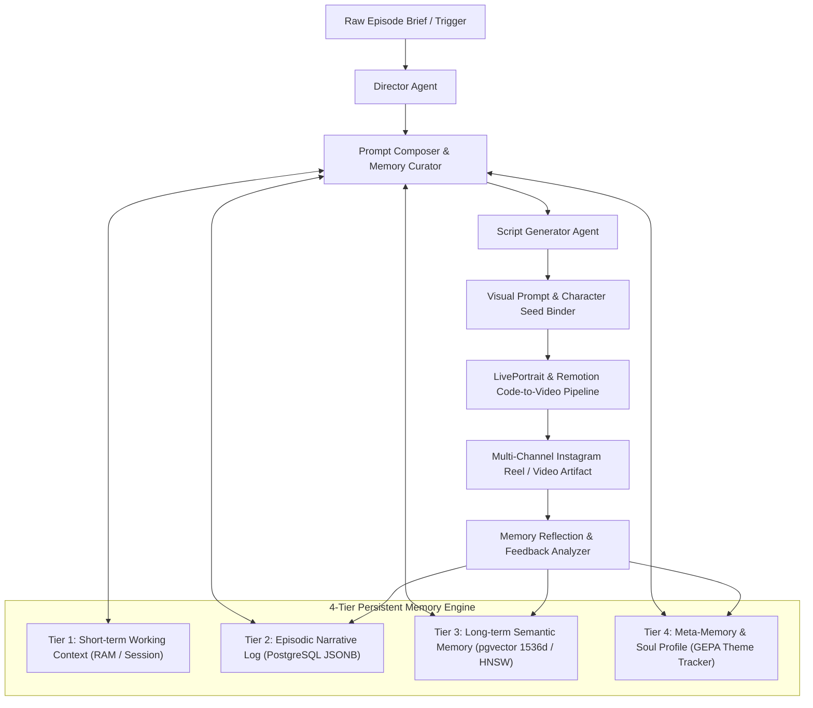

# Memory Architecture Guideline & Multi-Agent Character Continuity Engine

Production-grade 4-tier memory architecture, PostgreSQL pgvector semantic retrieval, and multi-agent character journey synchronization for 50+ episode continuity in automated content generation and Instagram Reels pipelines.

Authored by **Abhishek Soni** ([@meabhisheksoni](https://github.com/meabhisheksoni)).

---

## 📌 Executive Overview

When scaling automated content pipelines (e.g. YouTube series, web novels, episodic AI video, multi-niche Instagram Reels), AI agents quickly suffer from catastrophic context amnesia, hallucinated character backstories, and broken visual or psychological continuity.

This repository provides the reference architecture and concrete implementation extracted from a battle-tested content generation system. It demonstrates how to maintain coherent character arcs, consistent visual styling, thematic continuity, and persistent memory across 50+ episodes without context-window overflow.



---

## 🏛️ The 4-Tier Memory Hierarchy

| Tier | Name | Storage Mechanism | Retention Window | Purpose |
| :--- | :--- | :--- | :--- | :--- |
| **Tier 1** | **Working Memory** | Node.js Process State / Redis | Current Episode / Turn | Immediate prompt context, current scene constraints, active token budget. |
| **Tier 2** | **Episodic Narrative Log** | PostgreSQL `episodes`, `scenes` | 50+ Episodes Full History | Chronological events, past plot beats, character decisions, milestone outcomes. |
| **Tier 3** | **Semantic Anchor Memory** | PostgreSQL `pgvector` (cosine distance) | Permanent / Indexed | Vector embeddings of character traits, relationships, past conflicts, lore anchors. |
| **Tier 4** | **Soul & Meta Profile** | PostgreSQL `creator_profiles`, `project_soul` | Permanent Evolving State | Core character philosophy, voice tone, visual seed rules, pacing parameters. |

---

## 🎬 Character Journey & Arc Synchronization (Episodes 1 to 50)

To avoid episodic drift where a character's personality resets every episode, the pipeline divides a 50-episode run into 5 deterministic narrative phases tracked by `arcUtils.ts` and `MemoryCore.ts`:

1. **Episodes 1–10 (Genesis & The Call)**: Establishes base flaws, visual anchor seeds, and tone baseline.
2. **Episodes 11–20 (First Trials & Complications)**: Introduces secondary characters, tests flaws, records relationship vectors.
3. **Episodes 21–35 (Midpoint Climax & The Point of No Return)**: Irreversible character shift, core belief shattered, milestone snapshot committed.
4. **Episodes 36–45 (The Descent & Dark Night of the Soul)**: Consequences of past episodes emerge via semantic search across Episodes 1–35.
5. **Episodes 46–50 (Resolution & Transformation)**: Reconciles long-term arc with early episode anchors, validating thematic consistency.

---

## 📁 Repository Structure

```
.
├── README.md                                         # This documentation
├── MEMORY_ARCHITECTURE_GUIDELINE.md                  # Comprehensive 1,000+ line technical specification
├── MEMORY_AND_CHARACTER_VIDEO_PIPELINE_ARCHITECTURE.md # Architectural blueprint & deep dive
├── docker-compose.yml                                # PostgreSQL 16 + pgvector container definition
│
├── database/
│   ├── init.sql                                      # Database bootstrapping and extension init
│   └── migrations/
│       ├── 20260817_layer2_jobs_init.sql             # Background job runner queue
│       ├── 20260820_layer1_memory.sql                # Vector tables, HNSW indexes, semantic memory
│       ├── 20260820_layer3_gepa_init.sql             # Generative Evolutionary Prompt Adaptation (GEPA)
│       ├── 20260820_layer4_director.sql              # Director agent state & episode logs
│       └── 20260822_option_d_hardening.sql           # Schema constraints, foreign keys, transaction locks
│
├── server/
│   ├── memory/
│   │   ├── memoryCurator.ts                          # Context window budgeting and memory relevance ranking
│   │   ├── memoryTypes.ts                            # TypeScript schemas for memory nodes and vectors
│   │   ├── projectSoulAgent.ts                       # Project Soul extractor and persistent persona
│   │   └── creatorProfileAgent.ts                    # Creator voice tone and style anchor agent
│   ├── prompts/
│   │   ├── promptComposer.ts                         # Dynamic prompt injection with verified memory context
│   │   └── scriptGenerator.ts                        # Script generation respecting 50-episode arc constraints
│   └── agents/
│       └── directorAgent.ts                          # Autonomous orchestrator managing episode state transitions
│
└── core/
    ├── memory/
    │   ├── MemoryCore.ts                             # Client/runtime memory orchestrator
    │   ├── MemoryBridge.ts                           # Unified bridge between local cache and PostgreSQL backend
    │   ├── MemorySchemas.ts                          # Zod and TypeScript runtime validation schemas
    │   ├── SemanticGuard.ts                          # Semantic drift detector preventing character hallucinations
    │   └── RetryUtils.ts                             # SRE-grade resilient database retry wrappers
    ├── themeTracker/
    │   ├── memoryContext.ts                          # Thematic context aggregator for episode generation
    │   ├── themeExtractor.ts                         # Automatic theme and moral extraction from generated scripts
    │   └── feedbackAnalyzer.ts                       # Audience retention and engagement feedback analyzer
    └── services/
        └── arcUtils.ts                               # Narrative arc stage calculation and continuity math
```

---

## 🚀 Quick Start Guide

### 1. Prerequisites
- Docker & Docker Compose
- Node.js 18+ / 20+
- OpenAI API Key (or custom embedding model endpoint)

### 2. Launch Vector Database
```bash
docker-compose up -d postgres
```

Verify `pgvector` extension:
```bash
docker exec -it memory_postgres psql -U postgres -d content_memory -c "SELECT * FROM pg_extension WHERE extname = 'vector';"
```

### 3. Run Database Migrations
Execute the SQL migrations in order:
```bash
for file in database/migrations/*.sql; do
    docker exec -i memory_postgres psql -U postgres -d content_memory < "$file"
done
```

### 4. Querying Semantic Memory (Example SQL)
```sql
-- Retrieve the top 5 most relevant memories for the current episode scene
SELECT id, category, content, 1 - (embedding <=> $1) AS similarity
FROM episodic_memories
WHERE project_id = $2
  AND 1 - (embedding <=> $1) > 0.75
ORDER BY embedding <=> $1 ASC
LIMIT 5;
```

---

## 🎥 Instagram Code-to-Video Pipeline Blueprint

For automated multi-niche Instagram channels, each niche binds a dedicated **Project Soul** and **Character Seed Anchor**:

1. **Character Definition as Code**: Character appearance is defined via deterministic prompt seeds and negative embeddings rather than random prompts.
2. **Audio & Voice Cloning**: ElevenLabs voice synthesis conditioned on emotional mood flags retrieved from the character's current arc phase (`arcUtils.ts`).
3. **Facial Animation**: LivePortrait animation driven by rendered audio waveform landmarks.
4. **Dynamic Video Assembly**: Remotion code template overlays captions, dynamic zoom cuts, background motion vectors, and branded sound design.
5. **Post-Episode Memory Commit**: The episode script, key events, and audience comments are vectorized and committed to PostgreSQL for future episodes.

---

## 📖 In-Depth Specifications

For exhaustive mathematical details, complete SQL schemas, and step-by-step prompt templates, read the included guides:
- [MEMORY_ARCHITECTURE_GUIDELINE.md](MEMORY_ARCHITECTURE_GUIDELINE.md): Comprehensive 1,075-line engineering manual.
- [MEMORY_AND_CHARACTER_VIDEO_PIPELINE_ARCHITECTURE.md](MEMORY_AND_CHARACTER_VIDEO_PIPELINE_ARCHITECTURE.md): Full technical breakdown of the multi-agent video pipeline.

---

## 📄 License
MIT License. Free to use, adapt, and scale across your AI content pipelines.
